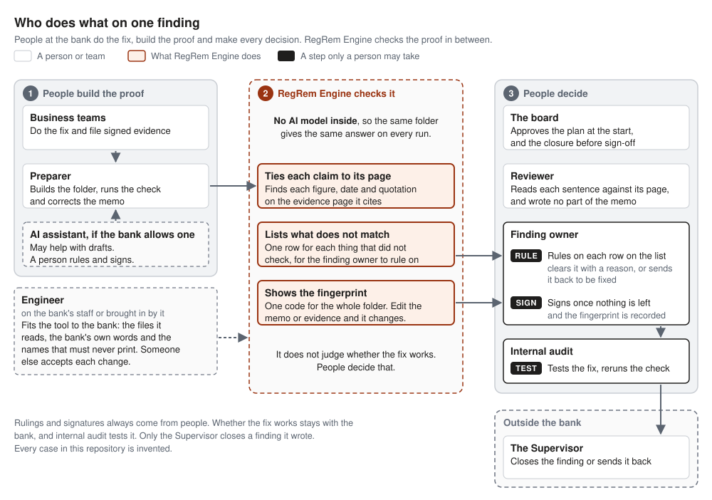
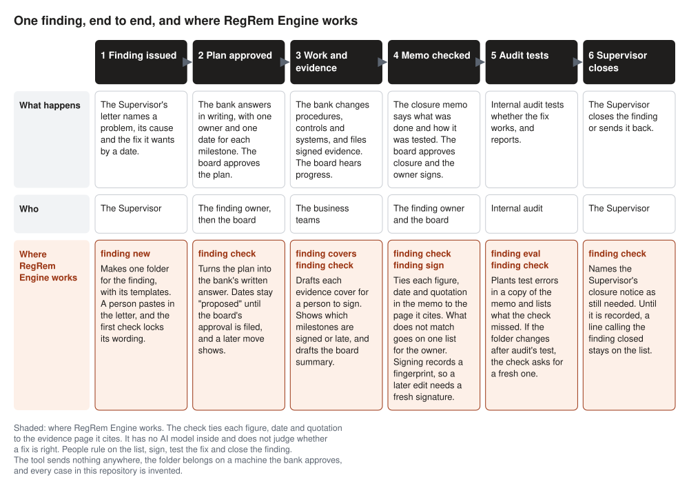
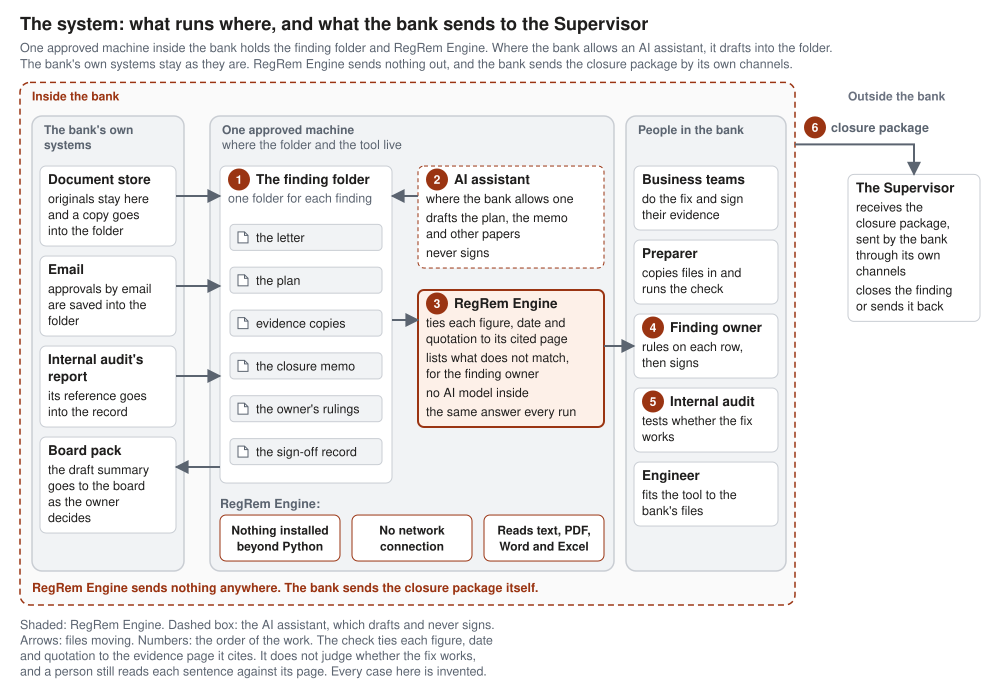

# RegRem Engine

**Check a bank's proof of a fix before it goes to the regulator.**

When a bank regulator finds a serious problem at a bank, it writes it up as a finding and sets a date for the fix. The bank fixes the problem, then proves it in a closure memo. The memo runs to pages of figures, dates and quotations, and each one points to a piece of evidence. If one number in that memo does not match its evidence, the package can come back, and the finding stays open.

RegRem Engine is an open-source tool that checks that proof. It reads the closure memo and the evidence folder, ties every figure, date and quotation to the page it cites, and puts whatever does not match on one short list. The person who owns the finding rules on each item before anyone signs. Internal audit can rerun the same check later and get the same answer, because there is no AI inside it.


A bank fixes a problem its regulator wrote up, then has to prove the fix. RegRem Engine works at the proving step, and people make every decision after it.


What it gives a bank:

- The owner gets one short list of the claims that do not match their evidence, so the reading starts where the problems are.
- The owner signs a fingerprint of everything checked, and any later change to the memo or the evidence asks for a fresh signature.
- Internal audit can repeat the test, since the same folder checked as of the same date gives the same result on any machine.
- Nothing is installed beyond plain Python, and the tool opens no network connection.

People still make the calls that matter. They decide whether the fix works, whether the evidence is the right evidence, and when the finding closes. The tool checks that each figure, date and quotation sits on the page the memo cites, and a person still reads each sentence against its page.


The check follows each figure, date and quotation in the memo to the page it cites. The right side shows what it cannot see, which is why a person still reads the memo.


RegRem is short for regulatory remediation. Every case in this repository is invented, and no bank has used the tool yet. [Status](#status) says what has been tested.



People at the bank do the fix, write the memo and make every decision. RegRem Engine sits between them, and an AI assistant only drafts, where the bank allows one at all.


## Try it in five minutes

Clone or download the whole repository, because the tool reads the folders beside it. Then run one command from its root folder:

```sh
python3 -I finding/finding.py check finding/cases/MRA-CMP-07 --today 2026-11-04
```

On Windows, type `py -I finding\finding.py` in place of `python3 -I finding/finding.py`. The `--today` option fixes the date, so your screen matches this page.

MRA-CMP-07 is an invented supervisory finding on complaint handling, nearly nine months into its remediation plan. The command prints each milestone's state, a draft board summary and the memo check, and it exits 1 because people still have work to do. This is the screen, trimmed where it shows `...`:

```text
This folder may hold confidential supervisory information. Keep it on a machine the bank has approved, and share nothing from it outside the bank.

Finding MRA-CMP-07, a supervisory finding from the Supervisor dated 2026-01-15. Owner: Head of Complaints. Checked as of 2026-11-04, kit release 0.7.0.

Milestones
M1 Approve revised complaint taxonomy. Head of Complaints, committed 2026-02-28. Present and signed on 2026-02-20.
M2 Reissue intake procedure. Head of Complaints, committed 2026-03-15. Present, unsigned: EV-08 was revised on 2026-04-02, after its signature of 2026-03-14. SLIPPED by 234 days.
M3 Quality review of reclassified complaints. Complaints QA lead, committed 2026-04-30. Present, unsigned: EV-12 is a draft. SLIPPED by 188 days.
M4 Extend taxonomy to the mobile app chat channel. Head of Digital, committed 2026-06-30. Not started. SLIPPED by 127 days.
...
Memo check: 13 claims, 7 tie, 3 on the list, 1 cleared.
  Line 8: 1,248 is cited to EV-07 p2, and the page does not hold it; the nearest figures on the page are 1,284 and 2. To rule, name: 1,248 #972adb19
  Line 10: EV-12, which is a draft, holds 4 claims, on lines 10, 15 and 16, that match its pages and wait on a person's signature. To rule, name: EV-12 draft #81b3b231
  Line 16: the sample period for M2 starts 2026-01-05, before the fix took effect on 2026-03-17, so the sample mixes items from before and after the fix. To rule, name: sample period for M2 #106ddd50
  Cleared: line 8, March 2026, by the Head of Complaints on 2026-11-04: The page says January to March, and the plan year is 2026.
  7 ties rest on text a person typed: 7 in plain-text evidence, none on a page typed into a cover.
  Not checked: 1 figure written in words, line 6 (three).
...
```

In the first row of the memo check, the memo says the team reclassified 1,248 complaints and cites page 2 of evidence file EV-07, the intake procedure. That page says 1,284. Two digits were swapped when someone typed the figure, the kind of slip a reader checking by eye can pass. The check names the line, the cite and the figures the page holds nearby. The owner rules `fix the memo` and someone corrects the figure. The tool would also accept `cleared` with a reason, so keeping a wrong figure off the cleared list is the owner's job.

The other two rows are of a different kind. EV-12, the quality review, is still a draft, so the four claims that match its pages wait on a person's signature. The sample it reports also starts before the fix took effect, which mixes items from before and after the fix. The walk in [finding/DEMO.md](finding/DEMO.md) runs every command on both invented cases, and [finding/README.md](finding/README.md) explains the folder and every rule the check applies.

## What it proves, and what it leaves to a person

An empty list means each figure and date written in digits, and each quotation, was found on the page its cite names. For a PDF with a text layer, a Word file, an Excel workbook, a CSV or a saved email, the tool reads that page from the document itself. A scanned page has no text, so a person types it into the file's cover and a second person checks the typing before anyone signs.

The check has no AI model inside it, so it gives the same answer on every run. It also checks the record around the memo. A milestone counts only while its evidence is signed and unchanged, and a line saying the finding is closed stays on the list until the closer's entry is recorded. The owner signs a fingerprint of the memo, rulings, board approval, letter, plan, evidence and the tool's own code, and any later change to those asks for a fresh signature.

A person still reads the memo. The check ties each claim to its own cited page and never compares one document with another, so two documents that disagree can both pass. A wrong figure that happens to sit on the cited page ties too. Figures written in words, bare years and dates with two-digit years are named on the page as not checked. Whether the fix works stays with the bank, internal audit tests it, and only the issuer closes the finding. The [Check section](finding/README.md#check) lists what a reviewer still reads for.

## The eval anyone can rerun

The eval plants errors in the memo one at a time, in memory, and counts how many the check catches. It changes nothing in the folder:

```sh
python3 -I finding/finding.py eval finding/cases/IA-CMP-02
```

```text
This folder may hold confidential supervisory information. Keep it on a machine the bank has approved, and share nothing from it outside the bank.

Eval of the memo check on IA-CMP-02. Nothing in the folder changed.
Planted 38 errors, one at a time, in the 13 claims that tie today.
  A figure with one digit changed: 6 planted, 6 caught.
  A figure with two digits swapped: 6 planted, 6 caught.
  A figure swapped for another on the same page: 6 planted, 0 caught.
  A date moved: 7 planted, 7 caught.
  A cite moved to another page: 13 planted, 11 caught.
Caught 30 of 38.
What the check did not catch, for a person to look for:
  Line 6: 2026-05-04 with its cite moved to EV-21 p2 still ties.
  Line 6: 120 changed to 118 still ties.
  Line 6: 118 changed to 120 still ties.
  Line 6: 98.3 percent changed to 120 still ties.
  Line 8: 402 changed to 410 still ties.
  Line 8: 410 changed to 402 still ties.
  Line 8: 98.0 percent changed to 410 still ties.
  Line 11: 2026-05-04 with its cite moved to EV-21 p2 still ties.
```

The check caught 30 of the 38 planted errors and none of the 6 figures swapped for another figure on the same page, which is its known blind spot. Its two missed cites moved to a page that also holds the same date. Every miss is listed by line, so a person knows where to look.

The library run checks the 21 invented cases in [library/](library/README.md), one for each kind of miss, against what each case says must happen:

```sh
python3 -I finding/finding.py eval --library
```

It ends with the line `Library cases: 21, 21 as expected, 6 of them a known limit.` Each known-limit case records something the check cannot see, so the limit stays written down.

## Guides

Six pages in docs/ show how the tool is used. Each one works on the invented cases, with commands you can rerun.

- [docs/how-it-works.md](docs/how-it-works.md): three diagrams of where the check sits in remediation, one finding through the commands, and how the folders fit.
- [docs/finding-owner.md](docs/finding-owner.md): for the person who owns a finding, how to read the list, rule on a row and sign.
- [docs/weekly-run.md](docs/weekly-run.md): one finding from Monday's check to Thursday's board cutoff, with who acts on each line.
- [docs/internal-audit.md](docs/internal-audit.md): a half-day plan for testing a closure package, including errors you plant yourself.
- [docs/first-week-engineer.md](docs/first-week-engineer.md): five days of fitting the kit to a bank, from the deny list to a site version and its acceptance.
- [docs/measuring-it.md](docs/measuring-it.md): how to time a finding by hand, replace the size assumptions and set a stop rule before a live run.

## Status

This is version 0.7.0, the first public release. Every case in it is invented, no bank has used it, and it has never run on a real finding. It was built with AI assistance under the author's direction.

The one larger test so far used a bigger invented finding of 61 files and 173 pages, which is kept out of this repository. In the first of three trial runs by AI agents, the check on its own caught 1 of the 13 traps planted in it. An AI agent reading the documents as the reviewer caught all 11 traps the run exercised, and the other 2 were never tried. That reviewer was the same agent that drafted the memo. So treat the check as a floor under a reviewer's reading, and keep a person reading each sentence against its page.

## How a finding is laid out



One finding moves through six steps, from the Supervisor's letter to closure. The shaded row shows what the tool does at each step, and people still rule on the list, sign, test the fix and close the finding.

Each finding is one folder that holds the regulator's letter, the plan, the evidence and the closure papers:

```text
MRA-CMP-07/
  finding.md           the letter, pasted under five headings
  plan.md              one row per milestone
  evidence/            one file per piece, each with a four-line cover
  closure/memo.md      the closure memo, with a cite after every claim
  closure/rulings.md   the owner's rulings on the list
  closure/record.md    board approval, signature, internal audit and closer
  closure/measures.md  hours booked, and what internal audit sent back (made by finding new; the invented cases have none)
  .finding-state.json  hashes, deny list and signature
```

The tool has seven commands:

- `new` makes a folder from the templates.
- `check` prints the page shown above.
- `sign` records the owner's signature at a terminal.
- `covers` drafts a cover for each document in evidence/.
- `eval` tests the check on a memo, and `eval --library` runs the library.
- `size` estimates the hours a finding takes, by hand and with the kit.
- `--version` confirms every file listed in [RELEASE.json](RELEASE.json) matches it.

## Drafting with an AI assistant

Every file the check reads is plain text or a document it reads itself, so any AI assistant a bank allows can draft into the folder. The pages in [assistant/](assistant/README.md) give one written procedure for each drafting job, covering the plan, the evidence covers, the closure memo, proposed rulings and answers to internal audit. The assistant never types a signature line, never writes the rulings or the record, and never signs. The check then reads what it wrote, and a person rules on whatever is left.

## What it reads

The reader takes a PDF with a text layer, a Word .docx file, an Excel .xlsx workbook, a CSV, an email saved as .eml, and plain text. It does no optical character recognition. The tool has no reader for Outlook .msg files, older Office formats, PowerPoint files or images. Each cited page of such a file is typed into its cover and checked by a second person, as a scan is.

## Fitting it to a bank



The folder and the tool sit on one machine the bank has approved. The tool opens no network connection, and the bank sends the closure package to the Supervisor through its own channels.

Three optional lists sit beside a finding or one folder up. The deny list, `denylist.txt`, holds names that must never print, and `role-words.txt` clears ordinary words the check took for names. A third, `size-assumptions.txt`, replaces the assumed hours with timed ones. The templates, plan columns and record fields are constants at the top of `finding/finding.py`.

A change to the tool's code changes every finding's fingerprint, and every page then names each kit file that differs from its release. Running `python3 -I finding/release.py` marks the kit as a site version such as 0.7.0+site.1, so a changed kit never reads as the published release. From then on the pages show only the site version, so a bank keeps its own log of which files changed.

## Delivering it through a forward-deployed team

Forward-deployed engineering is the industry's name for engineers placed with the team that uses a tool, to fit it where it runs. A bank's own engineering group or a firm's team placed with a bank could deliver this kit that way, since the work is fitting it to each bank's files. Until the release file is refreshed, every page names the kit files that changed. Running `python3 -I finding/release.py` then marks the kit as a site version, and the bank's own change log keeps the list of changed files. The eval and the library print what the check misses, and someone other than the engineer still reads and accepts what each change does. The page [docs/forward-deployed.md](docs/forward-deployed.md) sets out the three controls such a team needs, why the arrangement could change how remediation is delivered, and its limits. No bank has used the kit this way.

## Tests

```sh
python3 -I finding/selftest.py
python3 -I tieout/selftest.py
```

The first runs 1,166 expectations in the finding tool and the second runs 77 in the tie-out engine underneath. The engine's self-test starts a stand-in model server on this machine's loopback address, and nothing leaves the machine. The CI workflow in `.github/workflows/` runs both on Linux, macOS and Windows with Python 3.9 and 3.13. Windows has no pseudo-terminal, so the finding tool runs fewer expectations there.

## What is in this repository

- [finding/](finding/README.md): the tool, its document reader, two invented findings, a sample PDF and the self-test.
- [tieout/](tieout/README.md): the tie-out engine that ties a claim to its page, with its own self-test and invented matter. Its optional model step is off by default, and the finding tool never imports it.
- [library/](library/README.md): 21 invented eval cases, one for each kind of miss.
- [assistant/](assistant/README.md): the written procedure for each drafting job an AI assistant does.
- [docs/forward-deployed.md](docs/forward-deployed.md): the three controls a forward-deployed team delivering the kit would need, as a concept.
- [CHANGELOG.md](CHANGELOG.md), [CONTRIBUTING.md](CONTRIBUTING.md), [SECURITY.md](SECURITY.md), [LICENSE](LICENSE) and [NOTICE](NOTICE).

## Contributing and security

Never post confidential supervisory information, a real bank document or anything from a real finding in an issue or a pull request. An invented example shows a problem just as well. [CONTRIBUTING.md](CONTRIBUTING.md) says how to propose a change, and [SECURITY.md](SECURITY.md) says how to report a weakness privately.

## Licence

Apache License 2.0. See [LICENSE](LICENSE) and [NOTICE](NOTICE).

Personal project by Avinash Saraswat, made on my own time and my own machine. Files drafted with AI assistance under the author's direction. Views are my own. This repository is not a Google product and is not affiliated with Google.
