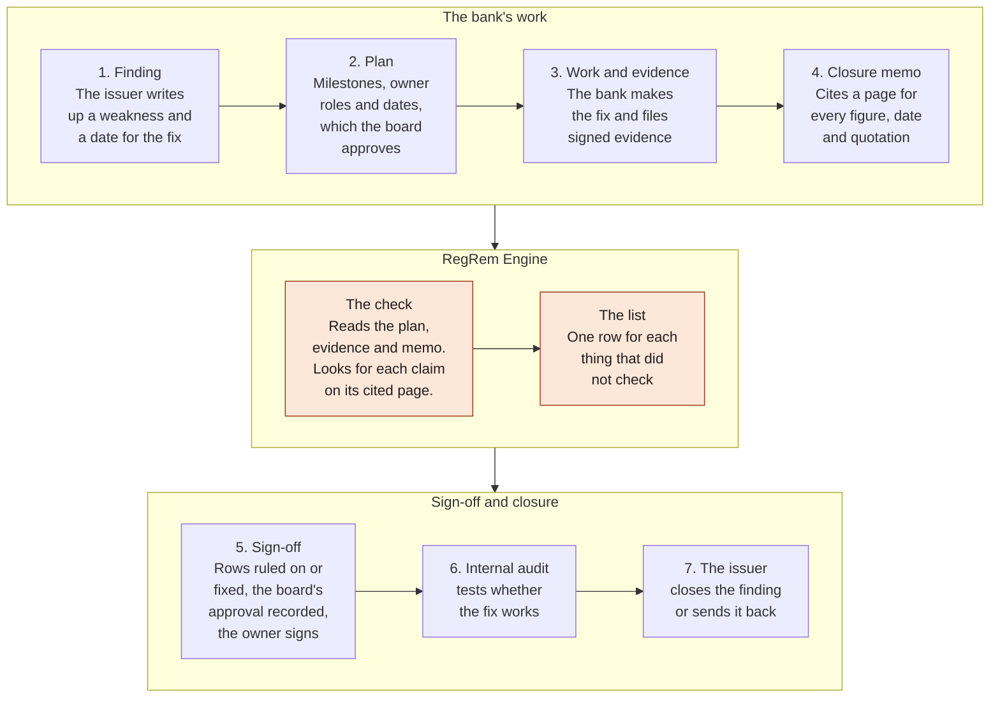
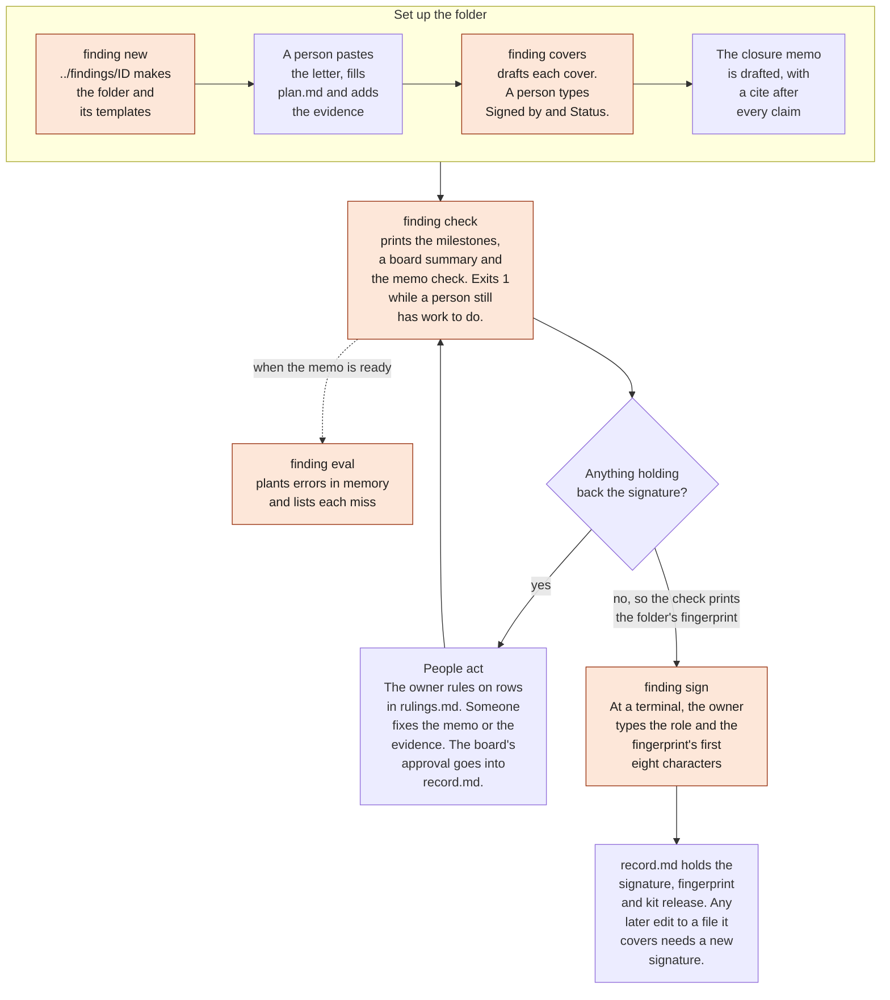
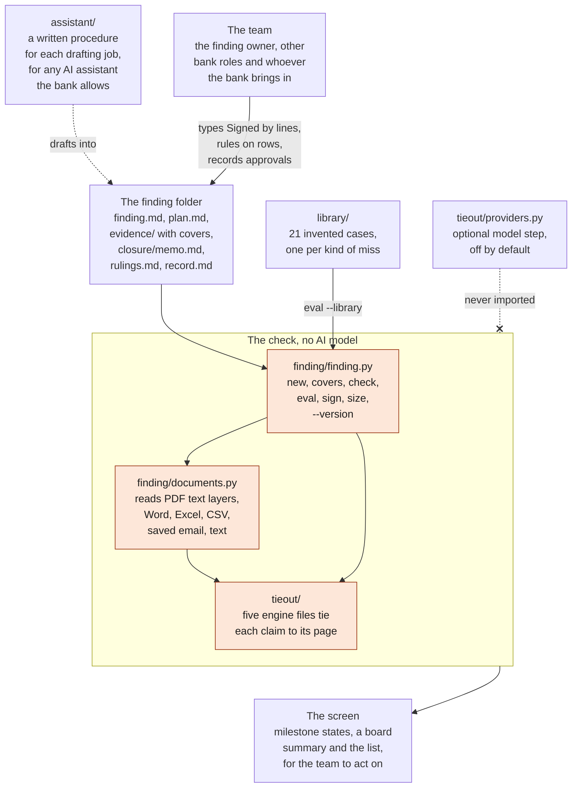

# How it works

The first diagram places the check inside remediation, the second walks one finding through the tool's commands, and the third shows how the folders of this repository fit together. All three are Mermaid text inside this file, which GitHub renders on the page, so changing a diagram is an ordinary text edit. Every finding and figure named here comes from the two invented cases in [finding/cases](../finding/README.md).

## What remediation is, and where the check sits

Remediation is the work a bank does to fix a weakness someone has written up, and to show with evidence that it did. The issuer is the Supervisor, the bank's internal audit, or for a weakness the bank found on its own, the bank's issue-management owner. The shaded check runs between the memo and the owner's signature, and it reads the plan and the evidence, so a milestone counts only while its evidence stays signed. Whether the fix works is for internal audit to test, and only the issuer can close the finding.

## One finding through the commands

Each shaded box is a command, run from the folder that holds finding/, where `finding` is short for `finding/finding`, and on Windows you type `py -I finding\finding.py` in its place. On the invented case MRA-CMP-07, checked as of 2026-11-04, the first row is a memo figure of 1,248 where the cited page says 1,284. A ruling is one line in closure/rulings.md, and the check prints each cleared row with its reason, so clearing that figure would stay in plain sight. On the other invented case, IA-CMP-02, nothing holds the signature back, so the check prints the fingerprint a381fa0f, and `sign` refuses piped input because it runs only at a terminal.

## How the pieces fit

The procedures in [assistant/](../assistant/README.md) tell whatever AI assistant the bank allows to draft into the folder and never to write the rulings or the record, or to sign. The finding tool reads the folder through its document reader and five files from [tieout/](../tieout/README.md). No AI model sits on that path, so one folder checked as of one date always gives the same page. The engine's optional model step lives in tieout/providers.py, off by default, and the finding tool never imports it. Each release has to pass all 21 invented cases in [library/](../library/README.md), and the six marked as a known limit keep a written record of what the check cannot see.

## Limits

The check looks for each claim only on the page its cite names, and it never sets two documents side by side. So a wrong figure ties whenever the cited page holds that same figure somewhere, and a person reads every sentence against its page. Every case in this repository is invented, and no bank has run the tool on a real finding. The [walk in finding/DEMO.md](../finding/DEMO.md) runs every command shown here, and [finding/README.md](../finding/README.md) sets out each rule the check applies.
